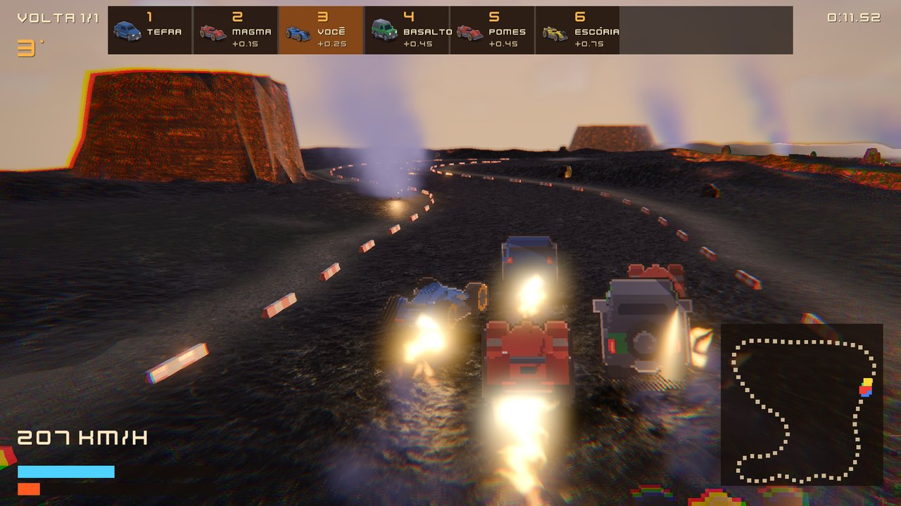
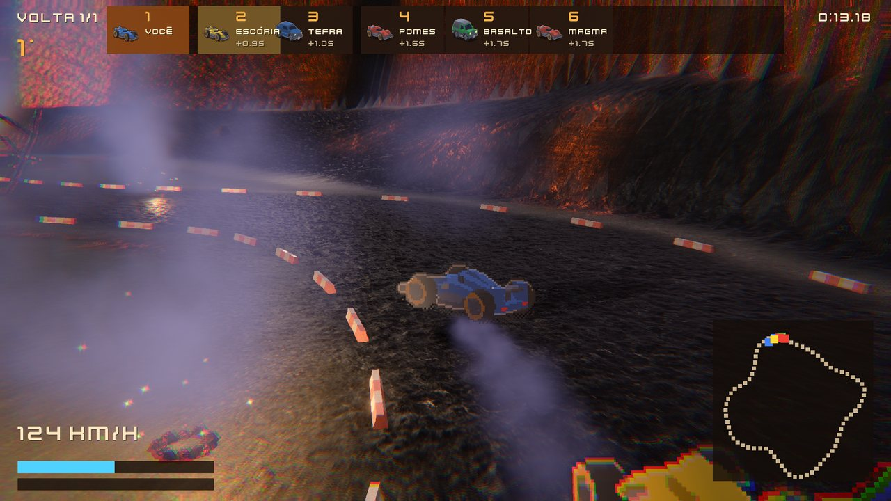
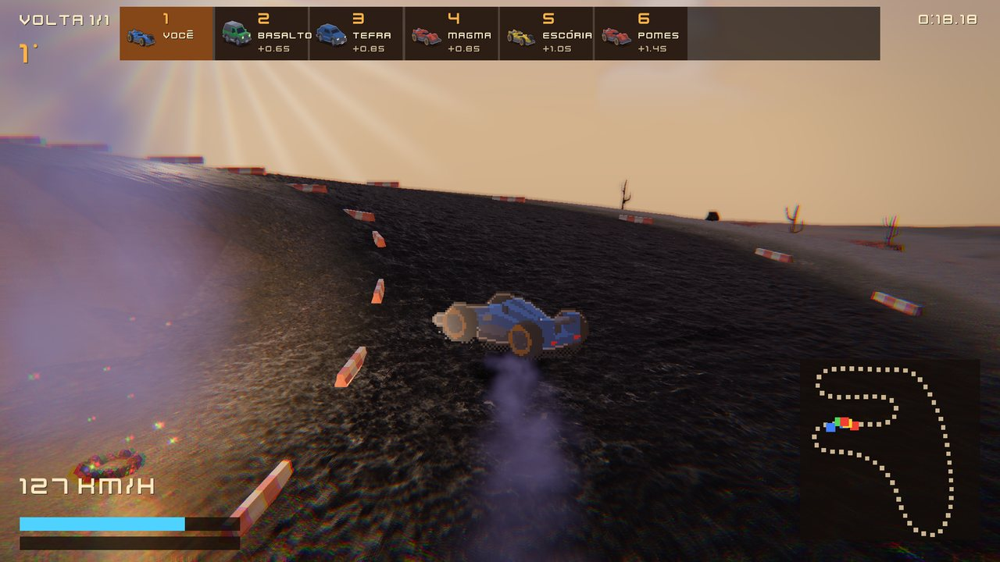
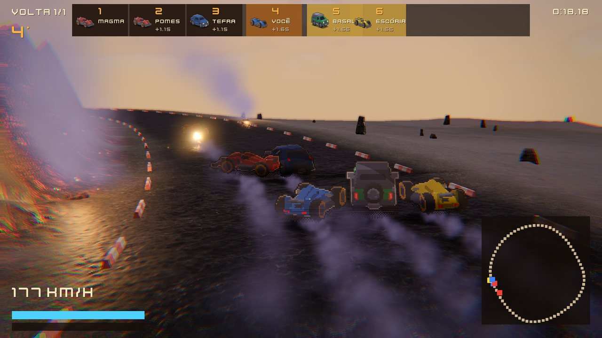
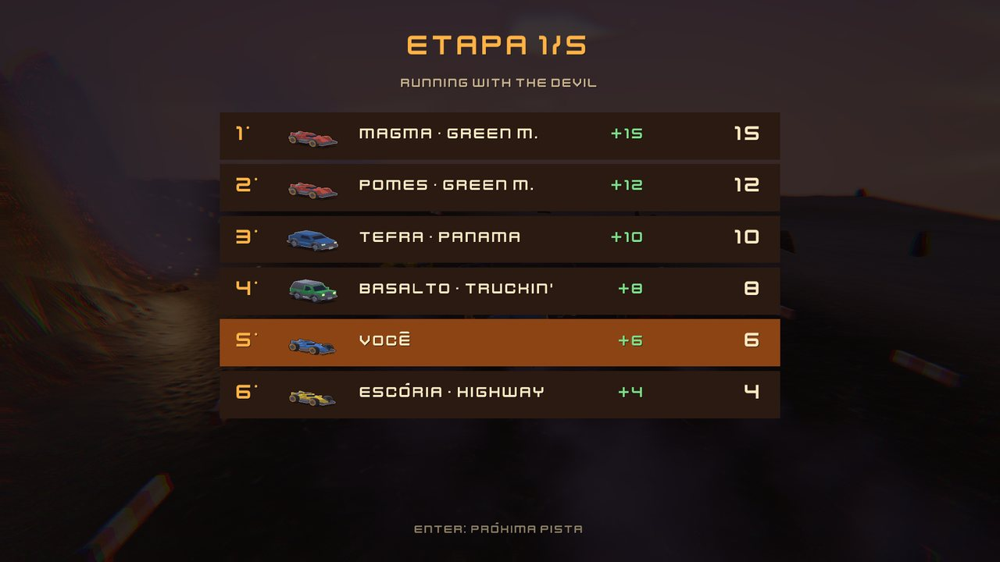
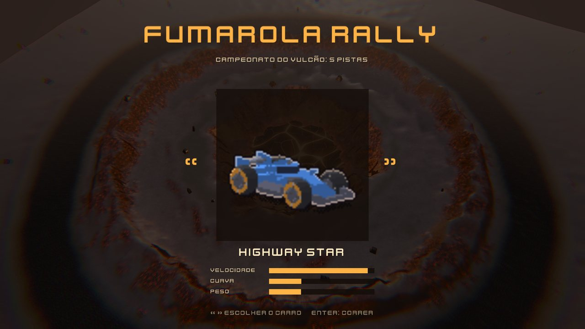

# Fumarola Rally

Corrida HD-2D nas encostas de um vulcão, feita no
[Eruption Engine™](https://github.com/eruptionlabs/eruption-engine). Os carros
são sprites em pixel art; a pista, a lava e as fumarolas são 3D com luz e
sombra. Mistura de kart com rally de 16 bits: campeonato de cinco pistas,
turbo que esquenta o motor e ranking de pontos entre as corridas.

O jogo também é um tutorial do motor: cada script faz uma coisa só.



## O jogo

- **Campeonato de 5 etapas**, 3 voltas cada. A etapa termina quando todos
  cruzam a linha ou quando você cruza e aperta Enter. Pontos por posição
  (15, 12, 10, 8, 6, 4…); na etapa seguinte o líder larga lá de trás.
- **4 carros**, cada um com ficha própria (potência, aderência, peso, quanto
  sofre com o calor). Os adversários usam faixas diferentes da pista e
  ultrapassam.
- **Turbo e calor**: o turbo gasta carga e esquenta o motor; passar do
  limite tira potência até esfriar. Chão de brasa também esquenta.
- **Música própria por pista**, hard rock e heavy dos anos 70/80.
- **Corrida em rede (PC e Android)**: no menu, *Criar sala* mostra o
  endereço (IP e porta) da máquina; os outros, na mesma rede, entram em
  *Entrar na sala* digitando esse IP. Quem abriu dá OK e todos correm o
  campeonato juntos (até 4 pessoas; o resto do grid é IA). Todos precisam da
  mesma versão do jogo. No navegador não há sala: lá não existe UDP.

| # | Pista | Título | Volta | O que tem |
|---|---|---|---|---|
| 1 | Caldeira | Running with the Devil | 2,2 km | laço na encosta de uma cratera com lago de lava |
| 2 | Cinzas | Smoke on the Water | 2,6 km | laço comprido entre morros de floresta queimada |
| 3 | Obsidiana | Paint It Black | 3,0 km | grampo, S e reta longa entre canais de lava e mesas de basalto |
| 4 | Anel | Ring of Fire | 2,6 km | dentro de uma cratera, contornando um lago de lava |
| 5 | Cume | Stairway to Heaven | 3,1 km | sobe 94 m em zigue-zague até o topo e desce em reta rápida |

| | |
|---|---|
|  |  |
|  |  |

Os nomes das pistas e dos carros homenageiam títulos de rock. Só o título:
nenhuma melodia, letra, gravação ou marca de terceiros está no jogo.



### Controles

| Ação | Teclado | Controle |
|---|---|---|
| Acelerar / frear | ↑ / ↓ (ou W / S) | A / B |
| Virar | ← / → (ou A / D) | direcional |
| Turbo | Espaço | RB |
| Escolher o carro, seguir | ← → e Enter | direcional e A |
| Criar sala / entrar na sala | C / E | X / Y |
| Desempenho na tela | F3 | |

## Rodar

Só precisa do binário do [Eruption Engine™](https://github.com/eruptionlabs/eruption-engine)
compilado. Na primeira vez, o motor converte as folhas dos carros no formato
dele (`.spr`, que fica fora do git por ser cache):

```bash
MOTOR=~/Documentos/eruption-engine/eruption-engine
for f in assets/sprites/carros/*.sheet.json; do a+=(--import-sprite "$PWD/$f"); done
(cd "$(dirname "$MOTOR")" && "$MOTOR" --project "$OLDPWD" "${a[@]}")
```

Depois, para jogar (o motor roda da pasta dele, onde estão os shaders):

```bash
(cd "$(dirname "$MOTOR")" && "$MOTOR" --project "$OLDPWD" --game)
```

### No navegador

**Jogar: [halen48.github.io/fumarola-rally](https://halen48.github.io/fumarola-rally/)**

A página (`docs/index.html`) baixa o jogo em pacotes gzip e roda sobre
**WebGL2**, então abre em qualquer navegador recente, no PC e no celular, sem
ligar nada. A primeira corrida baixa ~9 MB; as outras pistas descem com o jogo
rodando. No celular aparecem um analógico e os botões Turbo e OK.

A página e o jogo web moram em `docs/` (motor web e pacotes das pistas).
A versão web ainda não tem a fumaça, o brilho da lava, o céu e o tom final
da versão de PC.

## Como é feito

| Pasta | O que tem |
|---|---|
| `assets/scripts/` | O jogo, em Luau. `main.luau` é o laço; `lib/` tem uma peça por arquivo (física, IA, corrida, campeonato, HUD, câmera, visual, som, menu, ranking). |
| `assets/ui/` | Interface em CSS do motor (HUD, menu, ranking), editável no editor Caldera. |
| `assets/sprites/carros/` | Folhas de 16 direções de cada carro, renderizadas de modelos 3D CC0 e pixelizadas. |
| `assets/musica/` | A trilha, composta e gravada por nós. |
| `assets/external/`, `assets/scenes/` | Os mapas prontos: relevo, pintura do chão, lava, pedras e árvores. |
| `docs/` | A página web do jogo e as imagens deste README. |

Algumas escolhas de projeto:

- **Estado em colunas (SoA)**: cada carro é um índice em
  `lib/corpos.luau`; física, IA e desenho varrem colunas.
- **Física em passo fixo de 60 Hz**, função pura da entrada. O desenho
  interpola entre passos. Em rede só quem abriu a sala roda esse passo; os
  outros mandam o volante e recebem o estado dos carros 20 vezes por segundo
  (`lib/rede.luau`).
- **Comportamento pelo que a coisa faz, sofre e tem**, nunca pelo nome: o
  chão tem aderência e calor, o carro tem pneu e quanto sofre com o calor, e
  nenhum dos dois sabe o nome do outro.
- **16 direções com o motor lendo 8**: cada carro são dois sprites
  (direções pares e ímpares), e aparece o que estiver mais perto da câmera.

### Regras para mexer no jogo

- Cada script faz uma coisa e fica curto: quem lê aprende o motor.
- Estado do jogo em colunas; nada de tabela por carro no laço quente.
- Comportamento pelas qualidades (o que a coisa faz, sofre e tem), nunca
  pelo nome.
- Só assets CC0 ou nossos, cada um registrado em `assets/CREDITS.md`.
- Nada específico do jogo entra no motor. Recurso genérico que faltar vira
  pedido no repositório do motor.
- Mudança de visual ou de desempenho se prova com captura antes/depois
  (PSNR e tempo de GPU), como no motor.

### O que tem aqui

Este repositório tem só o jogo: os scripts em Luau e os assets já prontos.

## Créditos

Todo asset de terceiros é CC0. A lista completa, com a origem de cada arquivo,
está em [`assets/CREDITS.md`](assets/CREDITS.md):

- carros: Kenney (Car Kit);
- texturas: ambientCG;
- pedras e árvores: Quaternius;
- fonte e sons: Kenney;
- instrumentos da trilha: Karoryfer Samples e VCSL.

A música, os mapas, os efeitos e o código são nossos.
